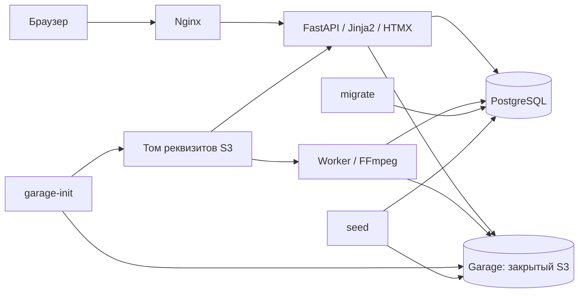
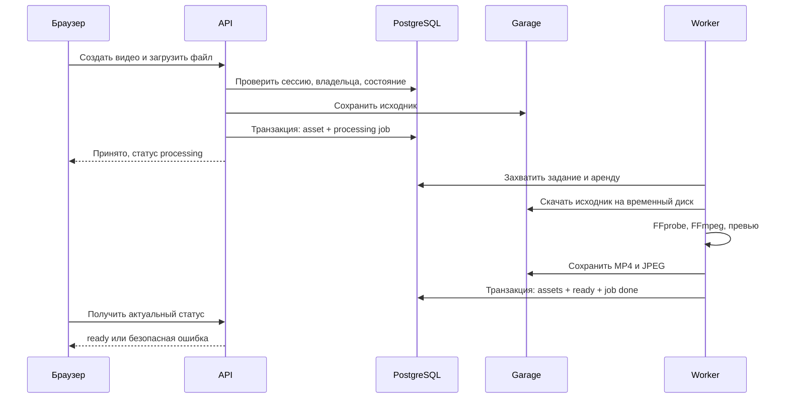
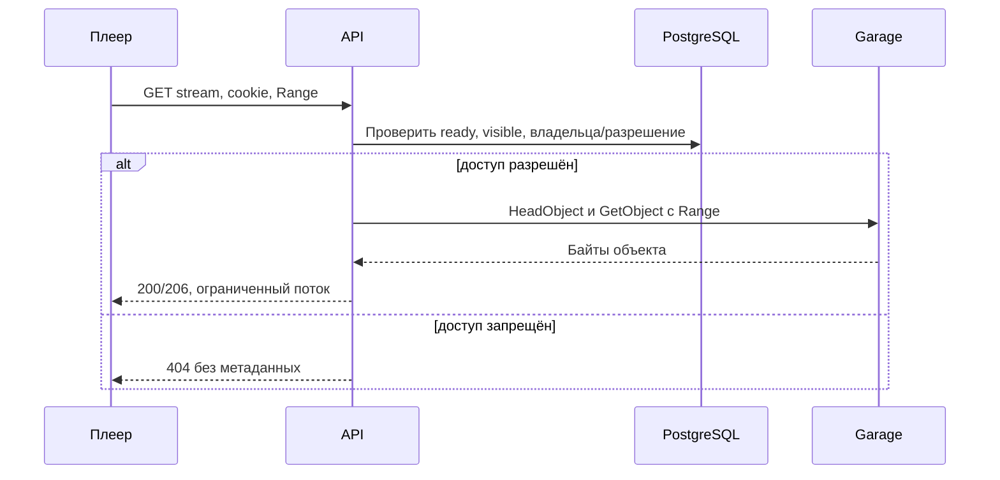
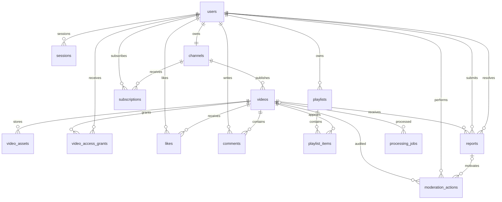

# Архитектура YouTube-копии

## 1. Цель, объём и принятые решения

Источник требований: `TZ-YouTube-kopiya.md`, прочитанный из `/Users/khaled/Downloads/TZ-YouTube-kopiya.md`. Это проектирование будущей системы: описанные ниже сервисы, таблицы и команды ещё не реализованы.

Цель за срок ТЗ в 10 дней — работающий видеосервис с главной лентой, просмотром, лайками, комментариями, каналами, подписками, плейлистами, поиском по названию, загрузкой с прогрессом, регистрацией и модерацией. Главный приёмочный сценарий: регистрация → загрузка → обработка → просмотр и перемотка → лайк → комментарий. Все восемь критериев ТЗ должны иметь проверяемый результат.

Выбран модульный монолит: один проект и общая модель данных, отдельные процессы web и worker. Это позволяет реализовать сквозные правила доступа и транзакции без межсервисных протоколов. Фоновая обработка изолирована от HTTP-процесса по ресурсам и жизненному циклу. Компромисс: приложение проксирует медиатрафик и рассчитано на демонстрационную нагрузку, а не масштаб YouTube.

| Компонент | Решение и ответственность |
| --- | --- |
| Backend | Python, FastAPI, Pydantic; JSON API `/api/v1`, Swagger `/docs` |
| Frontend | Jinja2 + HTMX, CSS и небольшой JavaScript; общий origin, HTML5 video, XHR для прогресса загрузки |
| Данные | PostgreSQL, SQLAlchemy 2, Alembic; метаданные, сессии и очередь заданий |
| Файлы | Garage с S3 API, boto3; закрытый бакет `videos`, случайные ключи объектов |
| Обработка | Отдельный worker из того же исходного проекта, FFprobe/FFmpeg |
| Входящий трафик | Nginx: прокси, статика, ограничения запросов, TLS для домена |
| Развёртывание | Docker Compose; одноразовые `garage-init`, `migrate`, `seed` |
| Проверки | Ruff, pytest, реальные PostgreSQL/Garage в интеграционных тестах, Playwright |

Модули: accounts, channels, videos, social, playlists, moderation; общий слой инфраструктуры БД/S3/очереди. Направление зависимостей: HTTP и HTML → прикладные сервисы → модели/репозитории и адаптеры. HTML не дублирует бизнес-правила API. Конкретные версии зависимостей и образов выбираются и фиксируются при создании каркаса; `latest` запрещён.

Обязательная версия использует MP4 с HTTP Range. HLS, несколько качеств, CDN, рекомендации ML, live-трансляции, OAuth, монетизация и возобновление загрузки не входят в обязательный объём. Система одноузловая, без отказоустойчивости; бэкап не заменяется репликацией.

## 2. Автоматический запуск Garage и Compose

### Зависимости и секреты

`garage` запускается с постоянными томами данных и метаданных, replication factor 1. PostgreSQL также имеет постоянный том. Наружу доступны только порты Nginx; S3, RPC, admin Garage и PostgreSQL остаются внутри Docker-сети.

Скрипт деплоя генерирует отсутствующие bootstrap-секреты и конфигурацию с ограниченными файловыми правами. Повторный запуск сохраняет их. RPC/admin-реквизиты Garage доступны серверу Garage и `garage-init`, но не web/worker. Секреты не попадают в build args, Git, stdout или shell tracing.

`garage-init` — одноразовый контейнер с CLI той же фиксированной версии, что Garage, и инструментом проверки S3. Он имеет read-write доступ к отдельному постоянному тому реквизитов. Web, worker и seed получают этот том read-only; конфигурация приложения поддерживает чтение access key/secret key из файлов. Файлы принадлежат выделенному UID/GID с минимальными правами чтения, запись выполняется атомарно через временный файл и rename. Это локальные файлы секретов, не обещание шифрования Docker volume.

Зависимости Compose:

- `garage-init` ожидает доступность Garage; готовность проверяет сам с общим таймаутом 180 секунд и интервалом до 5 секунд, без бесконечного ожидания.
- `migrate` ожидает `postgres: service_healthy`, запускает Alembic и завершается.
- Web и worker ожидают `garage-init: service_completed_successfully`, `migrate: service_completed_successfully` и готовую БД.
- Seed запускается отдельной одноразовой стадией деплоя после готовности инфраструктуры и worker; завершение всей команды деплоя включает ожидание готовых демо-видео.
- Ошибка init или миграции останавливает успешное завершение деплоя. Без готового хранилища web/worker не стартуют.

### Алгоритм garage-init

1. Получить блокировку инициализации на общем томе, чтобы два bootstrap-процесса не создавали разные ключи одновременно.
2. Дождаться доступности CLI/RPC Garage, получить идентификатор локального узла, текущую версию, назначенные роли и staged-изменения layout.
3. Для пустого layout назначить локальному узлу зону `local` и конфигурируемую ёмкость через `layout assign`. Проверить результат и применить именно следующую версию через `layout apply`. Ёмкость — планировочная настройка Garage, не замена ограничению диска.
4. При частично подготовленном layout применять только совпадающие с ожидаемой конфигурацией staged-изменения. Готовый совпадающий layout не менять. Чужие узлы, неожиданные staged-изменения или несовместимая конфигурация дают ошибку; не выполнять force/revert автоматически.
5. Найти или создать закрытый бакет `videos`; не включать website/public-доступ.
6. Найти именованный ключ приложения `youtube-app`. Если он уже создан, получить его существующие реквизиты через привилегированный CLI выбранной версии и восстановить файлы при необходимости; не создавать новый ключ при потере локального файла. Если ключ ещё не существует — создать и атомарно сохранить реквизиты. Возможность восстановления проверяется интеграционным тестом зафиксированной версии до приёмки init.
7. Выдать ключу только read/write на `videos`, без owner/admin. Проверить отсутствие нежелательных прав; неожиданные права считать ошибкой конфигурации, не расширять их молча.
8. Проверить S3 с реквизитами приложения: HEAD бакета, PUT/GET/Range/DELETE временного контрольного объекта в зарезервированном префиксе. Удалить объект и завершиться с кодом 0.

Существование контейнера или файла-маркера не доказывает инициализацию: проверяется реальное состояние Garage и доступ приложения. Повторный деплой повторно запускает проверку init без удаления томов; после аварийного завершения она продолжает с фактического состояния. В логах — только названия стадий и безопасные ошибки, без значений секретов. Никаких ручных `layout assign`, `layout apply`, `bucket create` и `key create` в инструкции обычного запуска.

Документация для реализации и проверки выбранной версии: [Garage Quick Start](https://garagehq.deuxfleurs.fr/documentation/quick-start/), [Garage CLI](https://garagehq.deuxfleurs.fr/documentation/reference-manual/cli/), [совместимость S3](https://garagehq.deuxfleurs.fr/documentation/reference-manual/s3-compatibility/). Поддержку используемых операций подтверждают тесты реального хранилища.

## 3. Загрузка, обработка и жизненный цикл

### Вход и состояния

Начальные изменяемые настройки: максимум 500 MiB фактически принятых байтов, максимум 30 минут, результат H.264/AAC MP4 до 1080p без upscale, JPEG-превью. Разрешённые контейнеры исходника: MP4/MOV/WebM/MKV; действительный формат и потоки подтверждает FFprobe. Файл без видеопотока отклоняется. Отсутствие аудио допускается. Входные сетевые URL, плейлисты и внешние ссылки не обрабатываются.

`POST /api/v1/videos` создаёт черновик, по умолчанию private. `POST /api/v1/videos/{id}/upload` принимает файл только от владельца, XHR показывает прогресс передачи; после передачи UI отдельно показывает обработку по опросу статуса. Финальный успех загрузки не означает готовности к просмотру.

API принимает файл на ограниченный временный диск, считает байты независимо от Content-Length и передаёт в S3 потоковым/multipart способом с ограниченными буферами. Прокси и приложение согласуют лимиты, включая служебный multipart overhead. Отключается избыточное буферизование прокси; лимит спулинга и заполнения диска проверяется. Синхронный boto3 не блокирует event loop.

Объектные ключи генерируются сервером: `originals/{video_id}/{upload_id}`, `processed/{video_id}/{generation_id}.mp4`, `thumbnails/{video_id}/{generation_id}.jpg`. Имена файлов пользователя не являются путями. После успешной записи исходника короткая транзакция сохраняет asset и задание. При сбое между S3 и БД возможен сиротский объект, который удалит сверка после защитного периода.

Состояния обработки: `pending → uploading → processing → ready`, при сбое `failed`. Повторная загрузка разрешена владельцу из `failed` с новым upload_id; конкурентные загрузки одного видео запрещены атомарной проверкой состояния. Видимость `public/private` и модерация `visible/hidden` — независимые поля. Удаление отмечается `deleted_at` и сразу запрещает доступ.

### Worker и согласованность

Очередь использует короткую транзакцию `FOR UPDATE SKIP LOCKED`; после назначения lease транзакция закрывается. Это применение предусмотрено [PostgreSQL для таблиц очередей](https://www.postgresql.org/docs/18/sql-select.html). Никаких блокировок БД на время FFmpeg.

Один worker обрабатывает одно видео одновременно по умолчанию. Аренда — 120 секунд с heartbeat каждые 30 секунд, максимум три попытки с задержками 30 и 120 секунд; таймаут обработки — 60 минут, настройки изменяемы. Детерминированно неверный файл не повторяется. Временная недоступность S3 повторяется. Истёкшая аренда возвращает задание в очередь; публикация результата проверяет lease token, чтобы устаревший worker не перезаписал результат нового.

FFprobe/FFmpeg работают без shell, от непривилегированного пользователя, без внешней сети для декодирования, с allowlist протоколов и лимитами CPU/RAM/временного диска. Результат получает `faststart`; перед ready проверяются наличие и размер обоих объектов. Частично записанный результат не становится видимым. Доставка заданий — как минимум один раз, поэтому операции идемпотентны, а уникальный deduplication key предотвращает повторное логическое задание.

Очистка периодически обрабатывает просроченные загрузки и multipart, временные файлы, неиспользуемые поколения и S3-объекты без ссылок старше 24 часов. Не удаляет объекты активных аренд. Удаление видео транзакционно ставит job со списком ключей; job удаляет объекты с безопасным повтором, затем очищает asset-строки. Soft-delete видео сохраняет связи с аудитом. Документируется невозможность общей ACID-транзакции PostgreSQL + S3 и механизмы компенсации.

## 4. Потоковая раздача и интерфейсы

`GET /api/v1/videos/{id}/stream` сначала проверяет сессию при её наличии и политику доступа; затем выполняет S3 HeadObject/GetObject. Тело читается ограниченными блоками, освобождая соединение при отключении клиента. Клиент не получает presigned URL или S3 credentials.

| Запрос | Поведение |
| --- | --- |
| GET без Range | 200, полный поток MP4 |
| GET с одним корректным `bytes=start-end`, `start-` или `-suffix` | 206, Content-Range, точный Content-Length |
| Непересекающийся диапазон | 416, `Content-Range: bytes */size` после проверки прав |
| Множественный или синтаксически неподдерживаемый Range | Игнорирование Range, 200 полного представления |
| HEAD | Проверка прав, 200 и заголовки полного представления без тела; Range игнорируется |

Заголовки: `Content-Type: video/mp4`, `Accept-Ranges: bytes`, Content-Length, ETag. If-Range с несовпадающим валидатором даёт полное представление. Для приватных медиа, превью и страниц — `Cache-Control: private, no-store`; общий кеш медиамаршрутов выключен в первой версии. Неавторизованный доступ к объекту возвращает 404 без раскрытия размера, заголовка и наличия файла. Инфраструктурные ошибки возвращаются без внутренних путей и секретов.

Другие группы интерфейсов: `/auth` (register/login/logout и текущая сессия), `/channels`, `/videos` (метаданные, список, поиск, upload, stream, thumbnail, grants), likes/comments, subscriptions, playlists/items, reports и `/moderation`. Операции выдачи/отзыва разрешения используют идентификатор зарегистрированного пользователя; входной DTO не позволяет менять owner/role/moderation_state. Пагинация списков: limit 20 по умолчанию, максимум 100, стабильная сортировка по дате и UUID. Поиск по названию без учёта регистра использует `pg_trgm` и фильтры доступа до пагинации.

Swagger описывает cookie-аутентификацию, CSRF-заголовок и ответы медиамаршрутов. Документация не публикует секреты или обходы прав. Страницы: `/`, `/watch/{id}`, `/channels/{handle}`, `/search`, `/upload`, `/login`, `/register`, `/moderation`, управление своими видео и плейлистами. Боковая навигация, верхний поиск, сетка превью и страница плеера повторяют привычное расположение YouTube без требования копирования чужих брендовых файлов.

## 5. Схема PostgreSQL

### Общие соглашения

UUID — первичные ключи сущностей. Для связей используются составные PK/UNIQUE. Время — `timestamptz` в UTC; created_at обязателен, updated_at добавляется к изменяемым сущностям. Все перечисленные поля NOT NULL, кроме явно отмеченных `?`. Перечисления задаются строками с CHECK и меняются миграциями. Все FK получают индексы, если не покрыты PK/UNIQUE или подходящим составным индексом.
Расширение `pg_trgm` создаётся той же Alembic-миграцией, что и GIN-индекс по заголовку видео.

Удаление пользователей в v1 заменено блокировкой; users/channels/videos сохраняются для аудита, их основные связи используют RESTRICT. Удаление видео логическое. CASCADE применяется к явно удаляемым зависимым связям (сессиям, разрешениям, элементам плейлиста), а не к истории модерации. Пароли хранятся только как Argon2id hash, токены сессий — как криптографический hash. Файлы и секретные S3-ключи доступа в БД приложения не хранятся.

| Таблица | Поля и типы | Ограничения и индексы |
| --- | --- | --- |
| users | id UUID; email_normalized varchar(254); username_normalized varchar(64); password_hash text; role varchar(16); is_active boolean; created_at, updated_at | UNIQUE email и username; role user/moderator/admin; активность проверяется на каждом запросе |
| sessions | id UUID; user_id FK users; token_hash char(64); csrf_token_hash char(64); expires_at timestamptz; created_at | UNIQUE token_hash; index expires_at и user_id; user FK CASCADE; выход удаляет/аннулирует сессию |
| channels | id UUID; user_id FK users; handle varchar(64); title varchar(120); description text; created_at, updated_at | UNIQUE user_id и нормализованный handle; user FK RESTRICT |
| videos | id UUID; channel_id FK channels; title varchar(200); description text; visibility varchar(8); processing_state varchar(16); moderation_state varchar(8); upload_id UUID?; duration_ms bigint?; width integer?; height integer?; failure_code varchar(64)?; deleted_at timestamptz?; created_at, updated_at | CHECK значений состояний и неотрицательной длительности, положительных размеров; index channel_id/created_at/id; частичный индекс публичной готовой ленты; GIN title gin_trgm_ops; channel FK RESTRICT |
| video_assets | id UUID; video_id FK videos; kind varchar(16); generation_id UUID; object_key text; size_bytes bigint; mime_type varchar(128); sha256 char(64); created_at | kind original/mp4/thumbnail; UNIQUE object_key и (video_id, kind); size_bytes > 0; video FK RESTRICT до выполнения очистки |
| video_access_grants | video_id FK videos; user_id FK users; granted_by FK users; created_at | PK(video_id,user_id); индекс user_id; video/user CASCADE, granted_by RESTRICT; владелец проверяется сервисом |
| likes | video_id FK videos; user_id FK users; created_at | PK(video_id,user_id); user index; связи CASCADE при явном физическом удалении зависимостей |
| comments | id UUID; video_id FK videos; user_id FK users; body text; deleted_at timestamptz?; created_at, updated_at | CHECK длины body 1..5000; index(video_id,created_at,id); FK RESTRICT; soft-delete |
| subscriptions | subscriber_id FK users; channel_id FK channels; created_at | PK(subscriber_id,channel_id), index channel_id; CASCADE; подписку на собственный канал запрещает сервис, поскольку владелец находится в другой таблице |
| playlists | id UUID; owner_id FK users; title varchar(200); visibility varchar(8); created_at, updated_at | visibility public/private; index(owner_id,created_at); owner RESTRICT |
| playlist_items | playlist_id FK playlists; video_id FK videos; position integer; created_at | PK(playlist_id,video_id), UNIQUE(playlist_id,position), position >= 0; playlist CASCADE, video RESTRICT; перестановка в транзакции под блокировкой плейлиста |
| reports | id UUID; video_id FK videos; reporter_id FK users; reason text; status varchar(16); resolved_by FK users?; resolved_at timestamptz?; created_at | status open/resolved/rejected; reason 1..2000; resolved_by/resolved_at заполнены только и обязательно для закрытой жалобы; частичный UNIQUE(video_id,reporter_id) WHERE status='open'; index(status,created_at); FK RESTRICT |
| moderation_actions | id UUID; video_id FK videos; actor_id FK users; report_id FK reports?; action varchar(16); reason text; created_at | action hide/restore; причина обязательна; index(video_id,created_at) и actor_id; FK RESTRICT; append-only через сервис |
| processing_jobs | id UUID; video_id FK videos?; kind varchar(16); deduplication_key text; payload jsonb; status varchar(16); attempts integer; max_attempts integer; run_after timestamptz; lease_until timestamptz?; lease_token UUID?; last_error text?; created_at, updated_at | kind transcode/delete/cleanup; status queued/running/succeeded/failed; UNIQUE deduplication_key; 0 <= attempts <= max_attempts, max_attempts > 0; lease_until/lease_token обязательны только в running; частичные индексы queued/run_after и running/lease_until; video RESTRICT |

Поле payload содержит только минимальные служебные данные задания, например список ключей на удаление, и валидируется по kind; не заменяет предметную схему. Шифрование паролей вместо хеширования не используется. Счётчики лайков/комментариев сначала вычисляются запросами, без денормализации и риска рассогласования.

## 6. Роли, приватность и защита

| Действие | Гость | Пользователь | Модератор | Администратор |
| --- | --- | --- | --- | --- |
| Смотреть public + ready + visible | Да | Да | Да | Да |
| Смотреть private + ready + visible | Нет | Только владелец/получатель grant | То же правило | То же правило |
| Загружать и управлять своими видео/плейлистами | Нет | Да | Да | Да |
| Выдавать/отзывать доступ | Нет | Только владелец видео | Только владелец видео | Только владелец видео |
| Лайк, комментарий, жалоба | Нет | При доступе к видео | При доступе к видео | При доступе к видео |
| Разбирать жалобы, скрывать/восстанавливать | Нет | Нет | Да | Да |
| Менять роли, блокировать аккаунты | Нет | Нет | Нет | Да |

Модерация не является разрешением на просмотр private: модератору доступны служебные сведения жалобы, состояние и решение; файл, превью и приватные описание/комментарии требуют grant. Публичные ленты, поиск и каналы включают только public/ready/visible/неудалённые записи. Собственные private доступны в кабинете; выданные пользователю — по защищённой ссылке. Содержимое плейлиста фильтруется по доступу до подсчёта и пагинации, само включение в публичный плейлист не раскрывает private.

Hidden не воспроизводится никем; владелец видит в кабинете статус и причину скрытия. Неактивный аккаунт не может использовать сессии; его видео исключаются из воспроизведения до разблокировки. Владелец может редактировать своё скрытое видео, но не сбрасывать статус модерации.

Единая политика can_view_video применяется к stream, HEAD, thumbnail, metadata, comments, likes и любому включению видео в выдачу. Отзыв grant действует на следующий запрос; уже начатый поток и полученные браузером байты отозвать невозможно. Это не DRM и не защита от копирования разрешённым зрителем.

Пароли — Argon2id; случайный непрозрачный токен сессии в HttpOnly cookie, SameSite=Lax, Secure в HTTPS-режиме. Сессия имеет фиксированный срок (по умолчанию 7 дней), смена роли/блокировка учитывается через БД на каждом запросе. Login меняет сессию; logout и блокировка отзывают её. Для изменяющих запросов проверяются CSRF token и Origin, включая login/register через предварительную CSRF-сессию/форму. CORS по умолчанию закрыт для чужих origin.

Экранирование Jinja2 включено, комментарии и описания — простой текст, произвольный HTML запрещён. Параметризованные запросы, allowlist полей DTO, лимиты строк и пагинации защищают от SQL injection и mass assignment. Ограничения частоты действуют на вход/регистрацию по IP и на загрузку/социальные действия по аккаунту. Логи не содержат cookie, паролей, access key или сырых пользовательских файлов. Административная операция смены роли не позволяет убрать последнего активного администратора.

## 7. Деплой, демо и эксплуатация

Целевая проверочная среда: чистая Ubuntu 24.04 LTS, Docker Engine + Compose plugin устанавливаются скриптом. Плановый минимум для демо — 2 CPU, 4 GiB RAM, 20 GiB свободного диска и доступ к сети для зависимостей/образов; фактические требования уточняются измерением обработки тестовых файлов. Все версии фиксируются, compose проверяется до запуска.

Будущая команда из распакованного репозитория: `sudo bash scripts/deploy.sh`. Сейчас файла ещё нет. Скрипт без интерактивных CLI-шагов устанавливает зависимости, создаёт недостающие секреты, поднимает БД/Garage, запускает init, миграции, приложение/worker, seed и проверку готовности. Возвращает ненулевой код при сбое любой стадии и сообщает URL после успеха. Повторный запуск сохраняет данные и секреты, не выполняет `down -v`, повторно проверяет init и применяет только новые миграции.

По IP допускается явно обозначенный тестовый HTTP-режим с Secure=false. При переданном домене и доступных 80/443 скрипт настраивает сертификат и HTTPS, редирект и Secure=true; неожиданная ошибка TLS не должна молча переключать публичный режим на HTTP.

Seed создаёт демо-пользователей всех ролей и несколько обычных пользователей, каналы, публичные/приватные/скрытые видео, grants, комментарии, лайки, подписки, плейлисты и жалобы. Ролики генерируются локально FFmpeg из тестовых изображений/звука без скачивания чужих видео, проходят тот же пайплайн. Идентификаторы стабильны, seed повторяемый, существующие пароли и пользовательские записи не сбрасывает. Сгенерированные демо-пароли сохраняются в защищённый файл вне Git; README описывает получение на сервере, вывод логов не раскрывает их. Демоданные обозначаются как тестовые.

Web предоставляет liveness и readiness; readiness проверяет БД и бакет, не раскрывая реквизиты. Worker публикует heartbeat; отслеживаются возраст очереди, число failed jobs, ошибки HTTP, доступность S3 и заполнение диска. Логи структурированы, с request_id/job_id, ограничением размера и ротацией.

Для согласованного бэкапа приостанавливаются записи и worker, затем сохраняются PostgreSQL (`pg_dump`), S3-объекты и необходимые конфигурации/секреты в защищённое хранилище. Нельзя обещать согласованность произвольного копирования живых томов. Восстановление проверяется на отдельной среде: миграционная версия, ключи, приватность и чтение видео. Обновление не удаляет тома; перед несовместимой миграцией нужен бэкап и план восстановления.

## 8. Проверка и связь с ТЗ

| Критерий ТЗ | Что предъявляем |
| --- | --- |
| 1. Объём | Все обязательные экраны, социальные функции, плейлисты, роли и рабочий видеопайплайн |
| 2. Похожесть | Адаптивная сетка превью, навигация, поиск, канал и плеер в привычном расположении |
| 3. Разворачиваемость | Одна команда на чистой Ubuntu, init Garage, миграции, seed, healthchecks и повторный запуск |
| 4. Архитектура | Этот документ, диаграммы, границы модулей и объяснение компромиссов |
| 5. БД | ER-схема, таблицы, ограничения, индексы и проверяемые миграции |
| 6. ИИ и обвязка | AGENTS.md, исходные проектные диалоги и реально использованная обвязка |
| 7. Безопасность | Матрица доступа, закрытое S3, CSRF/XSS/IDOR-тесты, безопасные сессии и обработка файлов |
| 8. Git | Атомарные коммиты с обновлениями TODO; весь `.git` в сдаваемом ZIP |

Обязательные тестовые сценарии:

- Полный браузерный путь от регистрации до лайка/комментария, включая перемотку и ожидание обработки.
- Public/private/hidden/pending/failed/deleted и активность владельца; гость, владелец, получатель grant, посторонний, модератор и администратор. Отзыв grant проверяется на новом Range и HEAD, а также через превью и комментарии.
- Отсутствие утечек в поиске, каналах, плейлистах и счётчиках; пользователь не может сменить владельца, роль или статус модерации запросом.
- Начальный, конечный, открытый, суффиксный, недостижимый, множественный Range, HEAD, If-Range и закрытие S3-соединения при отключении клиента.
- Ложный MIME/Content-Length, повреждённый файл, файл без видео, превышение размера/длительности, исчерпание временного диска, прерванная загрузка.
- Недоступность S3, рестарт worker, истёкшая аренда, повторная доставка, отказ между S3 и коммитом БД, идемпотентное удаление без затрагивания чужих объектов.
- Ограничения PostgreSQL, конкурентные лайки/подписки, перестановка плейлиста, CSRF, XSS, IDOR, ограничения частоты и выход из сессии.
- Garage на пустых томах: layout, ключ, бакет и реальные PUT/GET/Range/DELETE без ручного вмешательства. Повторный запуск сохраняет те же реквизиты и данные.
- Остановка init после assign, apply, создания ключа и до записи файла секретов; повторный запуск восстанавливается. Несовместимый layout даёт понятную ошибку без изменений; web/worker не стартуют при неуспехе init.
- Чистая Ubuntu: одна команда, пригодные демо-данные, работающий пользовательский сценарий; повторный деплой, сохранность данных и восстановление бэкапа.
- Итоговый ZIP распаковывается, содержит `.git` с историей и исходные диалоги, не содержит рабочих секретов/томов/кешей; запуск проверен из распакованной копии.

Интеграционные тесты используют реальные PostgreSQL и Garage: mocks не подтверждают S3 Range, права бакета и конкурентные ограничения БД. На текущем документационном этапе проверяются полнота, согласованность ссылок и требований; запуск приложения и тесты инфраструктуры относятся к последующим пунктам TODO.
